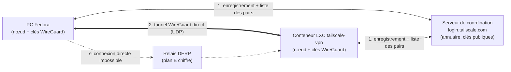
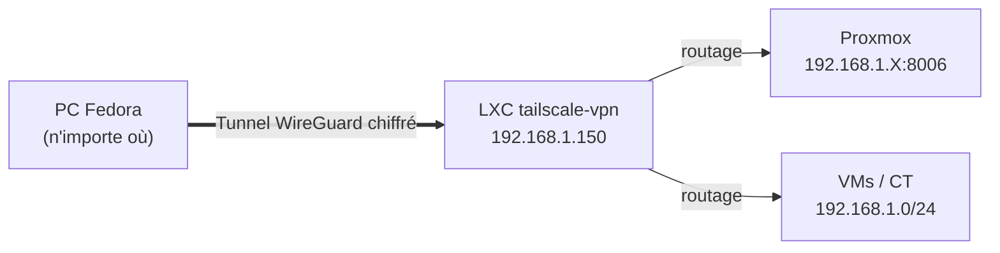

# Tailscale sur Proxmox : accès distant via un conteneur LXC Debian (Subnet Router)

> **Objectif** : accéder à distance à l'interface Proxmox et à tout son réseau local (VMs, conteneurs) depuis un PC Fedora, sans ouvrir de port sur la box, grâce à Tailscale installé dans un conteneur LXC Debian qui joue le rôle de passerelle.

---

## Sommaire

1. [Comprendre Tailscale](#1-comprendre-tailscale)
2. [Architecture du montage](#2-architecture-du-montage)
3. [Procédure d'installation](#3-procédure-dinstallation)
4. [Vérifications et dépannage](#4-vérifications-et-dépannage)
5. [Récapitulatif des commandes](#5-récapitulatif-des-commandes)

---

## 1. Comprendre Tailscale

### 1.1 Qu'est-ce que Tailscale ?

Tailscale est un service de **VPN maillé (mesh VPN)** construit sur **WireGuard**, un protocole VPN moderne, rapide et léger, intégré au noyau Linux.

Différence avec un VPN classique :

| VPN classique (OpenVPN, WireGuard « road warrior ») | Tailscale (mesh) |
|---|---|
| Un serveur central à héberger et exposer | Pas de serveur VPN à héberger |
| Tout le trafic passe par ce serveur | Chaque machine parle **directement** aux autres |
| Port à ouvrir et rediriger sur la box | **Aucun port entrant** à ouvrir |
| Gestion manuelle des clés et des configs | Clés et configs distribuées automatiquement |

Le même programme (`tailscaled`, piloté par la commande `tailscale`) sert de **client et de nœud**. Il n'y a pas de « version serveur » et de « version client » : c'est le même binaire, qui s'adapte selon les options de lancement.

### 1.2 Vocabulaire

| Terme | Signification |
|---|---|
| **Tailnet** | Ton réseau privé virtuel personnel : l'ensemble des machines rattachées à ton compte |
| **Nœud (node)** | Une machine qui exécute Tailscale (Fedora, conteneur LXC, téléphone…) |
| **IP Tailscale** | Adresse stable en `100.x.y.z` (plage CGNAT `100.64.0.0/10`) attribuée à chaque nœud, qui ne change pas quel que soit le réseau où la machine se trouve |
| **Serveur de coordination** | Annuaire central (`login.tailscale.com`) : authentification, distribution des clés publiques et de la liste des pairs |
| **DERP** | Serveurs relais chiffrés utilisés en dernier recours quand la connexion directe est impossible |
| **Subnet Router** | Nœud qui annonce un sous-réseau local au tailnet et sert de passerelle vers lui |
| **MagicDNS** | Résolution de noms automatique des machines du tailnet (ex. `tailscale-vpn`) |

### 1.3 Les trois acteurs



- **Le serveur de coordination ne voit jamais ton trafic.** Il ne stocke que les clés *publiques* et les informations nécessaires pour que les machines se trouvent.
- **Les machines échangent leur trafic directement**, chiffré de bout en bout.
- **DERP** ne sert que de secours, et ne peut pas déchiffrer ce qu'il relaie.

### 1.4 Ce qui se passe quand on lance `tailscale up`

1. **Génération des clés** : la machine crée sa paire de clés WireGuard. La clé privée ne quitte jamais la machine.
2. **Authentification** : le lien `https://login.tailscale.com/a/...` te fait te connecter avec un compte (Google, Microsoft, GitHub…). La machine est rattachée à ton tailnet.
3. **Enregistrement** : la machine envoie au serveur de coordination sa clé publique et ses informations réseau (IP locale, IP publique vue de l'extérieur).
4. **Attribution d'une IP Tailscale** (`100.x.y.z`).
5. **Distribution des pairs** : le serveur envoie à chaque machine la liste des autres nœuds autorisés et leurs clés publiques. Une interface virtuelle `tailscale0` est créée.
6. **Établissement du tunnel** : quand une machine veut joindre une autre, les deux tentent une connexion UDP WireGuard directe.

### 1.5 Le franchissement des NAT et pare-feu

Les deux machines sont presque toujours derrière une box ou un partage de connexion (NAT), donc injoignables depuis l'extérieur. Tailscale contourne cela :

- **NAT traversal (STUN + hole punching)** : chaque machine découvre son adresse publique, puis les deux envoient des paquets UDP l'une vers l'autre *en même temps*. Les NAT interprètent ces paquets comme des réponses légitimes et laissent passer le trafic. Le tunnel s'ouvre **sans aucune configuration sur la box**.
- **Repli sur DERP** : si le hole punching échoue (NAT strict, réseau d'entreprise, 4G restrictive), le trafic passe par un relais DERP (via HTTPS). C'est plus lent, mais toujours chiffré de bout en bout. Tailscale retente régulièrement de repasser en direct.

La commande `tailscale status` indique si une connexion est `direct` ou passe par un `relay`.

### 1.6 Le rôle du Subnet Router

Dans ce montage, Tailscale n'est installé **que** sur le conteneur LXC et sur le PC Fedora, pas sur Proxmox ni sur les autres VMs. Pour atteindre tout le réseau local (`192.168.1.0/24`), le conteneur joue le rôle de **passerelle** :

- l'option `--advertise-routes=192.168.1.0/24` annonce au tailnet : « je sais joindre ce sous-réseau » ;
- la route doit être **approuvée** dans la console web Tailscale (sécurité : une machine ne peut pas s'attribuer un sous-réseau toute seule) ;
- depuis Fedora, un paquet vers `192.168.1.X` entre dans le tunnel, arrive au conteneur, qui le transmet sur le réseau local comme s'il était sur place.



### 1.7 Sécurité

- Chiffrement de bout en bout (WireGuard : ChaCha20-Poly1305).
- Authentification par clés publiques ; seules les machines de ton compte se voient.
- Aucun port entrant ouvert sur la box.
- Possibilité de restreindre les accès avec les **ACL** Tailscale (qui peut joindre quoi).
- Les clés des nœuds expirent par défaut après un certain délai (à renouveler ou à désactiver dans la console pour un serveur permanent).

---

## 2. Architecture du montage

| Élément | Rôle | Exemple |
|---|---|---|
| PC Fedora | Client Tailscale (là où tu te trouves) | IP Tailscale `100.x.y.z` |
| Conteneur LXC `tailscale-vpn` | Nœud Tailscale + Subnet Router | `192.168.1.150/24` (IP locale fixe) |
| Proxmox + VMs | Machines à atteindre (réseau local) | `192.168.1.0/24` |
| Compte Tailscale | Lie les machines dans le même tailnet | Google / Microsoft / GitHub |

> Adapter `192.168.1.0/24` au sous-réseau réel du Proxmox si la plage est différente.

---

## 3. Procédure d'installation

### Étape 1 : Télécharger le template Debian

1. Se connecter à l'interface web de Proxmox.
2. Aller dans le stockage, souvent nommé **local**, sur le nœud.
3. Cliquer sur **CT Templates**, puis sur **Templates**.
4. Chercher **debian-12-standard** et cliquer sur **Download**.
5. Attendre la fin du téléchargement.

### Étape 2 : Créer le conteneur LXC

Cliquer sur **Create CT** en haut à droite, puis renseigner chaque onglet :

| Onglet | Paramètre | Valeur |
|---|---|---|
| **Général** | Node | le nœud actuel |
| | CT ID | par défaut ou un numéro au choix (ex. 100) |
| | Hostname | `tailscale-vpn` |
| | Password / Confirm | mot de passe root (à retenir) |
| **Template** | Template | le template Debian téléchargé |
| **Disques** | Storage | `local-lvm` (ou le stockage principal) |
| | Disk size | 2 ou 4 Go (largement suffisant) |
| **CPU** | Cores | 1 |
| **Mémoire** | Memory | 512 Mo (256 Mo possible) |
| | Swap | 512 Mo |
| **Réseau** | Bridge | `vmbr0` (ou le bridge habituel) |
| | IPv4 | IP fixe du réseau local, ex. `192.168.1.150/24` (masque `/24` ou `/28` selon le réseau) |
| | Gateway | IP de la passerelle (routeur ou téléphone) |
| **DNS** | | valeurs par défaut (ex. `1.1.1.1` ou `8.8.8.8`) |

Vérifier le récapitulatif, puis cliquer sur **Finish**. Proxmox crée et démarre le conteneur en quelques secondes.

### Étape 3 : Installer Tailscale dans le conteneur

1. Dans l'arborescence Proxmox, cliquer sur le conteneur `tailscale-vpn` (ID 100), puis sur l'onglet **Console**.
2. Se connecter en **root** avec le mot de passe défini à la création.
3. Installer Tailscale avec le script officiel :

   ```bash
   curl -fsSL https://tailscale.com/install.sh | sh
   ```

4. Activer et démarrer le service :

   ```bash
   systemctl enable tailscaled
   systemctl start tailscaled
   ```

### Étape 3 bis : Donner `/dev/net/tun` au conteneur (si `tailscaled` ne démarre pas)

Par défaut, un conteneur LXC n'a pas accès au périphérique `/dev/net/tun`, nécessaire à la création de l'interface VPN. Il faut le lui donner depuis l'hôte.

**A. Sur l'hôte Proxmox (pas dans le conteneur)**

1. Charger le module et vérifier le périphérique :

   ```bash
   modprobe tun
   ls -l /dev/net/tun
   ```

   Résultat attendu : `crw-rw-rw- 1 root root 10, 200 ... /dev/net/tun`. Si le fichier n'existe pas, `modprobe tun` le crée.

2. Rendre le chargement permanent au démarrage de l'hôte :

   ```bash
   echo tun >> /etc/modules
   ```

**B. Configurer le conteneur (sur l'hôte Proxmox)**

1. Trouver l'ID du conteneur `tailscale-vpn` (noté `XXX` ci-dessous) :

   ```bash
   pct list
   ```

2. Arrêter le conteneur et éditer sa configuration :

   ```bash
   pct stop XXX
   nano /etc/pve/lxc/XXX.conf
   ```

3. Ajouter ces deux lignes à la fin du fichier :

   ```
   lxc.cgroup2.devices.allow: c 10:200 rwm
   lxc.mount.entry: /dev/net/tun dev/net/tun none bind,create=file
   ```

4. Redémarrer le conteneur :

   ```bash
   pct start XXX
   ```

**C. Dans le conteneur**

Vérifier le périphérique, relancer le service et contrôler son état :

```bash
ls -l /dev/net/tun
systemctl reset-failed tailscaled
systemctl restart tailscaled
systemctl status tailscaled
```

### Étape 3 ter : Authentifier le conteneur

1. Lancer :

   ```bash
   tailscale up
   ```

2. Le terminal affiche un lien du type `https://login.tailscale.com/a/xxxxxxxxxxxxx`.
3. Copier ce lien dans le navigateur du PC et se connecter avec un compte (Google, Microsoft ou GitHub). Le conteneur est alors lié au compte Tailscale.

### Étape 4 : Activer le routage (Subnet Router)

Le conteneur doit annoncer le réseau local pour donner accès à tout le Proxmox et aux autres VMs/conteneurs.

1. Dans la console du conteneur :

   ```bash
   sudo tailscale up --advertise-routes=192.168.1.0/24 --accept-dns=false
   ```

   Remplacer `192.168.1.0/24` par le sous-réseau exact du Proxmox si la plage est différente.

2. Approuver la route dans le tableau de bord web Tailscale :
   - trouver la machine `tailscale-vpn` ;
   - cliquer sur les trois points `...` à côté de la machine ;
   - choisir **Edit route settings** ;
   - cocher la case pour approuver le sous-réseau.

> **Ajout recommandé (absent de la procédure d'origine)** : un Subnet Router doit pouvoir transférer les paquets. Activer le routage IP dans le conteneur :
>
> ```bash
> echo 'net.ipv4.ip_forward = 1' | sudo tee /etc/sysctl.d/99-tailscale.conf
> sudo sysctl -p /etc/sysctl.d/99-tailscale.conf
> ```
>
> Si le routage ne fonctionne pas malgré la route approuvée, c'est le premier point à vérifier.

### Étape 5 : Installer et connecter le client Fedora

Le programme est le même que sur le conteneur : un seul binaire sert de client et de nœud.

1. Installer et activer le service :

   ```bash
   curl -fsSL https://tailscale.com/install.sh | sh
   sudo systemctl enable --now tailscaled
   ```

2. Se connecter en acceptant les routes annoncées par le conteneur :

   ```bash
   sudo tailscale up --accept-routes
   ```

   > L'option `--accept-routes` est **absente de la procédure d'origine**. Sans elle, le sous-réseau `192.168.1.0/24` peut rester injoignable depuis Fedora.

3. Copier le lien affiché dans le navigateur et se connecter avec **le même compte** que pour le conteneur.
4. Vérifier que le conteneur apparaît dans la liste des appareils :

   ```bash
   tailscale status
   ```

### Étape 6 : Utilisation

Depuis Fedora, ouvrir le navigateur et aller sur l'adresse du Proxmox, par exemple :

```
https://192.168.1.X:8006
```

L'accès fonctionne de n'importe où, tant que Tailscale est actif sur Fedora.

---

## 4. Vérifications et dépannage

| Symptôme | Piste |
|---|---|
| `tailscaled` en échec dans le LXC | Vérifier `/dev/net/tun` (étape 3 bis), puis `systemctl reset-failed tailscaled && systemctl restart tailscaled` |
| `/dev/net/tun` absent sur l'hôte | `modprobe tun` puis `echo tun >> /etc/modules` |
| Le conteneur n'apparaît pas dans `tailscale status` | Vérifier que Fedora et le conteneur utilisent **le même compte** |
| Proxmox injoignable en `192.168.1.X` | Route non approuvée dans la console, `--accept-routes` oublié sur Fedora, ou `ip_forward` non activé dans le LXC |
| Connexion lente | `tailscale status` : si `relay`, la connexion passe par DERP au lieu d'être directe |
| Accès Internet du conteneur impossible | Vérifier IP fixe, masque et passerelle du conteneur (étape 2) |

Commandes utiles :

```bash
tailscale status          # liste des machines et type de connexion (direct / relay)
tailscale ip -4           # IP Tailscale de la machine locale
tailscale ping <machine>  # test de connectivité via Tailscale
tailscale netcheck        # diagnostic réseau (NAT, DERP)
```

---

## 5. Récapitulatif des commandes

**Hôte Proxmox**

```bash
modprobe tun
ls -l /dev/net/tun
echo tun >> /etc/modules
pct list
pct stop XXX
nano /etc/pve/lxc/XXX.conf     # ajouter les 2 lignes lxc.*
pct start XXX
```

**Conteneur LXC Debian**

```bash
curl -fsSL https://tailscale.com/install.sh | sh
systemctl enable tailscaled
systemctl start tailscaled
tailscale up
echo 'net.ipv4.ip_forward = 1' | sudo tee /etc/sysctl.d/99-tailscale.conf
sudo sysctl -p /etc/sysctl.d/99-tailscale.conf
sudo tailscale up --advertise-routes=192.168.1.0/24 --accept-dns=false
```

**PC Fedora**

```bash
curl -fsSL https://tailscale.com/install.sh | sh
sudo systemctl enable --now tailscaled
sudo tailscale up --accept-routes
tailscale status
```
